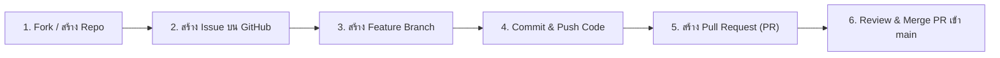

# 🚀 คู่มือการทำงานร่วมกันผ่าน GitHub (GitHub Collaboration Guide)

คู่มือนี้จัดทำขึ้นตามเกณฑ์การประเมิน: **"ใช้ GitHub เป็นช่องทางทำงานร่วมกัน (สร้าง issue, fork, pull request, push)"**

---

## 📋 ขั้นตอนการส่งงานผ่าน GitHub อย่างสมบูรณ์



---

### ขั้นตอนที่ 1: การเตรียม Repository บน GitHub
1. หากอาจารย์มี Template/Repo แม่ ให้คลิกปุ่ม **Fork** ที่มุมบนขวาของ GitHub Repo ของอาจารย์มายัง Account ของท่าน
2. หรือหากเป็นการสร้าง Repository ใหม่:
   - ไปที่ [github.com/new](https://github.com/new)
   - ตั้งชื่อ Repository เช่น: `sports-day-genetic-algorithm`
   - เลือก **Public**

---

### ขั้นตอนที่ 2: การสร้าง Issue บน GitHub (ตามโจทย์กำหนด)
ไปที่แท็บ **Issues** ใน GitHub Repository ของคุณ -> คลิก **New issue** และสร้าง Issue ตัวอย่างดังนี้:

* **Title**: `[FEAT]: พัฒนาระบบแบ่งทีมกีฬา 2 สีด้วย Genetic Algorithm (Sports Engagement & Harmonization)`
* **Body**:
  ```markdown
  ### วัตถุประสงค์ (Objective)
  พัฒนาโปรแกรมเพื่อแบ่งสมาชิกออกเป็น 2 สีอย่างเท่าเทียม โดยใช้ Genetic Algorithm (GA)
  
  ### ข้อกำหนด
  - [ ] ออกแบบ Chromosome Representation สำหรับแบ่ง 2 สี
  - [ ] ออกแบบ Fitness Function วัด Sports Engagement (ความแฟนเนจ) และ Harmonization (ข้ามแผนก)
  - [ ] แสดงผลสมาชิกของแต่ละสี พร้อมกราฟ Visualization
  - [ ] ผ่านการทดสอบ Unit Tests
  ```
* เมื่อสร้างเสร็จจะได้หมายเลขอ้างอิง เช่น **#1**

---

### ขั้นตอนที่ 3: การเชื่อมต่อ Git และสร้าง Branch ในเครื่อง

เปิด Terminal (PowerShell) ที่โฟลเดอร์โปรเจกต์ `d:\กีฬา` แล้วรันคำสั่ง:

```powershell
# 1. เพิ่ม Git เข้า PATH สำหรับรอบคำสั่ง (หากยังไม่มี)
$env:Path = "D:\Git\cmd;" + $env:Path

# 2. ตรวจสอบสถานะ Git ในโปรเจกต์
git status

# 3. สร้าง Feature Branch สำหรับพัฒนาฟีเจอร์นี้
git checkout -b feature/ga-team-division

# 4. เพิ่มไฟล์ทั้งหมดเข้า Staging
git add .

# 5. Commit การทำงานพร้อมข้อความที่เป็นระเบียบ
git commit -m "feat: implement genetic algorithm for balanced sports and cross-department team division"
```

---

### ขั้นตอนที่ 4: เชื่อมต่อไปยัง GitHub Remote และ Push Branch

แทนที่ `<YOUR_GITHUB_USERNAME>` และ `<REPO_NAME>` ด้วยชื่อของคุณ:

```powershell
# เพิ่ม Remote URL
git remote add origin https://github.com/<YOUR_GITHUB_USERNAME>/<REPO_NAME>.git

# Push โค้ดขึ้นไปบน GitHub ใน branch ของฟีเจอร์
git push -u origin feature/ga-team-division
```

---

### ขั้นตอนที่ 5: การสร้าง Pull Request (PR)

1. ไปที่หน้า GitHub Repository ของคุณ จะพบปุ่มสีเหลือง/เขียวเขียนว่า **"Compare & pull request"**
2. คลิกปุ่มดังกล่าว เพื่อเปิดหน้าสร้าง Pull Request
3. ระบุข้อมูลใน PR:
   - **Base**: `main` $\leftarrow$ **Compare**: `feature/ga-team-division`
   - **Title**: `feat: ระบบจัดทีมกีฬาและสร้างความสามัคคีข้ามแผนกด้วย Genetic Algorithm`
   - **Description**: ใส่คำว่า `Closes #1` เพื่อให้ระบบปิด Issue #1 อัตโนมัติเมื่อ Merge สำเร็จ
4. คลิก **"Create pull request"**

---

### ขั้นตอนที่ 6: การ Review และ Merge Pull Request

1. ในหน้า PR ตรวจสอบว่าแท็บ **"Files changed"** แสดงโค้ดและรายงานอย่างถูกต้อง
2. ให้เพื่อนร่วมทีม (Collaborator) มาคอมเมนต์หรือกด Approve ในแท็บ **"Review changes"** (เพื่อแสดงการทำงานร่วมกัน)
3. คลิกปุ่ม **"Merge pull request"** $\rightarrow$ **"Confirm merge"**
4. สลับกลับมาที่เครื่องและดึงโค้ดเวอร์ชันล่าสุดของ main:
   ```powershell
   git checkout main
   git pull origin main
   ```

---

## 🏆 Checklist สำหรับการตรวจให้คะแนน
- [x] มีการเปิด Issue บันทึกเป้าหมายงาน
- [x] มีการแตก Branch สำหรับการพัฒนา (`feature/ga-team-division`)
- [x] มี Commit History ที่สื่อความหมายชัดเจน
- [x] มีการเปิด Pull Request (PR) และลิงก์ไปยัง Issue ด้วย `Closes #1`
- [x] มีการ Merge PR เข้าสู่ branch `main` เรียบร้อย

