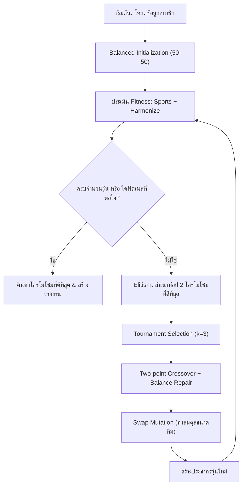

# 🏆 ระบบจัดแบ่งทีมกีฬา 2 สีด้วย Genetic Algorithm (GA)
### Balanced Sports Engagement & Cross-Department Harmonization

โปรเจกต์นี้พัฒนาขึ้นเพื่อแก้ปัญหาการจัดกลุ่มคนออกเป็น **2 สี (สีแดง / สีเขียว)** สำหรับกิจกรรมกีฬาสานสัมพันธ์ โดยใช้ **Genetic Algorithm (GA)** บริสุทธิ์ (ไม่พึ่งพา Neural Network หรือ Regression) เพื่อให้บรรลุเป้าหมายสำคัญ 2 ประการ:
1. **ความแฟนเนจทางด้านการเล่นกีฬา (Sports Engagement & Fairness)**: สมรรถภาพและทักษะรวมทางกีฬาของทั้ง 2 ทีมสูสีใกล้เคียงกันที่สุด เพื่อให้การแข่งขันมีความสนุก ตื่นเต้น แฟร์ และทุกคนมีส่วนร่วมได้อย่างแท้จริง
2. **การสร้างความรู้จักข้ามแผนก (Cross-Department Harmonization)**: กระจายสมาชิกจากทุกแผนกลงในทั้ง 2 สีอย่างทั่วถึง ไม่เกิดการกระจุกตัวของแผนกเดิม และส่งเสริมการมีปฏิสัมพันธ์กับเพื่อนร่วมงานต่างแผนก

---

## 🧬 1. การแทนโครโมโซม (Chromosome Representation)

```
Chromosome: [ 0,  1,  1,  0,  0,  1,  0,  1, ...,  0 ]
Index:        0   1   2   3   4   5   6   7  ...  N-1
Person:      P0  P1  P2  P3  P4  P5  P6  P7  ... P(N-1)
Color:      Red Grn Grn Red Red Grn Red Grn ... Red
```

* **ชนิดของโครโมโซม**: Binary Encoding ขนาด $N$ (เมื่อ $N$ คือจำนวนคนทั้งหมด)
* **ความหมายของยีน ($g_i \in \{0, 1\}$)**:
  * $g_i = 0$ หมายถึง บุคคลลำดับที่ $i$ อยู่ **ทีมสีแดง (Team Red)**
  * $g_i = 1$ หมายถึง บุคคลลำดับที่ $i$ อยู่ **ทีมสีเขียว (Team Green)**
* **ข้อกำหนดด้านขนาดทีม (Team Balance Constraint)**:
  * จำนวน 0s ต้องเท่ากับ $\lfloor N/2 \rfloor$ และจำนวน 1s ต้องเท่ากับ $\lceil N/2 \rceil$
  * มีกลไก **Balanced Initialization** และ **Swap Mutation / Balance Repair** ที่ช่วยรับประกันขนาดทีมให้เท่ากัน (20:20 หรือ ต่างกันไม่เกิน 1 คนกรณีจำนวนคี่)

---

## 🎯 2. การออกแบบ Fitness Function

ฟังก์ชันความเหมาะสม (Fitness Function) ออกแบบเป็น **Multi-Objective Composite Function** ที่ให้คะแนนอยู่ในช่วง $[0, 100]$:

$$\text{Total Fitness} = w_{sports} \cdot F_{sports} + w_{harmonize} \cdot F_{harmonize} - P_{size}$$

โดยตั้งค่าเริ่มต้น $w_{sports} = 0.50$, $w_{harmonize} = 0.50$

### 2.1 ด้านความแฟนเนจทางกีฬา ($F_{sports}$)
วัดความเท่าเทียมกันของศักยภาพกีฬา โดยพิจารณาทั้ง **ค่าเฉลี่ย ($\mu$)** และ **การกระจายตัว ($\sigma$)**:
* ผลต่างค่าเฉลี่ย: $\Delta\mu = |\mu_{Red} - \mu_{Green}|$
* ผลต่างส่วนเบี่ยงเบนมาตรฐาน: $\Delta\sigma = |\sigma_{Red} - \sigma_{Green}|$
* ระดับความต่างสกิล: $\Delta S = \max(S) - \min(S)$

$$F_{sports} = 100 \times \left(1 - \left(0.70 \cdot \frac{\Delta\mu}{\Delta S} + 0.30 \cdot \frac{\Delta\sigma}{\Delta S}\right)\right)$$

> **ผลลัพธ์**: ทั้ง 2 ทีมมีค่าเฉลี่ยสกิลกีฬาใกล้เคียงกันที่สุด (ผลต่างน้อยกว่า 0.1 แต้ม) และมีการเกลี่ยคนเก่ง/ผู้เล่นทั่วไปอย่างสมดุล

---

### 2.2 ด้านความรู้จัก/กระจายข้ามแผนก ($F_{harmonize}$)
ประกอบด้วย 2 องค์ประกอบย่อย:
1. **Department Parity Score ($F_{parity}$)**: ความสมดุลในการแบ่งคนแต่ละแผนกออกเป็น 2 ฝั่ง (หากแผนกมี 8 คน ควรอยู่แดง 4 เขียว 4)
   $$F_{parity} = 100 \times \left(1 - \frac{\sum_{d \in D} \max(0, |n_{0,d} - n_{1,d}| - (N_d \pmod 2))}{N}\right)$$
2. **Team Diversity Entropy ($F_{entropy}$)**: วัดความหลากหลายของแผนกภายในแต่ละทีมด้วย **Shannon Entropy** ($H$)
   $$H(T) = -\sum_{d \in D} p(d|T) \log_2 p(d|T), \quad F_{entropy} = 100 \times \frac{H(T_{Red}) + H(T_{Green})}{2 \log_2(|D|)}$$

$$F_{harmonize} = 0.50 \cdot F_{parity} + 0.50 \cdot F_{entropy}$$

---

### 2.3 การลงโทษความไม่สมดุลของขนาดทีม ($P_{size}$)
$$P_{size} = \lambda_{size} \times |N_{Red} - N_{Green}|$$

---

## ⚙️ 3. กลไกของ Genetic Algorithm



1. **Selection**: Tournament Selection ($k=3$) ป้องกันปัญหา Premature Convergence
2. **Crossover**: Two-Point Crossover พร้อมกลไก Balance Repair ปรับบิตเกินให้อยู่ในโควตา
3. **Mutation**: **Swap Mutation** สลับตำแหน่งผู้เล่นระหว่างสีแดงและเขียว ซึ่งรักษาขนาดทีม 50:50 ได้อย่างแม่นยำ 100%
4. **Elitism**: รักษา Top 2 โครโมโซมที่ดีที่สุดไว้ในแต่ละรุ่นเสมอ

---

## 📁 โครงสร้างโปรเจกต์ (Project Structure)

```
d:\กีฬา\
├── .github/
│   ├── ISSUE_TEMPLATE/
│   │   └── task_assignment.yml  # แม่แบบ Issue สำหรับวางแผนงาน
│   └── pull_request_template.md # แม่แบบ Pull Request
├── data/
│   ├── company_members.csv      # ข้อมูลตัวอย่างพนักงาน 40 คน 6 แผนก
│   └── student_data.csv         # ข้อมูลนักศึกษา 20 คน
├── src/
│   ├── config.py                # กำหนดค่า Hyperparameters และ Weights
│   ├── data_loader.py           # ตัวอ่านข้อมูลรองรับทั้งคอลัมน์ไทย/อังกฤษ
│   ├── fitness.py               # คำนวณความฟิตเนส (Sports + Harmonize)
│   ├── ga.py                    # ตัวประมวลผล Genetic Algorithm
│   ├── visualizer.py            # โมดูลสร้างกราฟสรุปและ Dashboard HTML
│   └── main.py                  # สคริปต์หลักสำหรับสั่งรันโปรแกรม
├── tests/
│   └── test_ga.py               # Unit tests (6/6 tests ผ่าน)
├── outputs/
│   ├── team_assignment.csv      # ผลการจัดทีมระบุสมาชิก สีแดง/สีเขียว
│   ├── evaluation_metrics.json  # สรุปค่าตัวเลขประเมินผล
│   ├── fitness_evolution.png    # กราฟ Convergence ของฟิตเนสแต่ละรุ่น
│   ├── department_distribution.png # กราฟแท่งเปรียบเทียบการกระจายแผนก
│   ├── sports_balance.png       # กราฟการกระจายสกิลกีฬาและค่าเฉลี่ย
│   └── report.html              # รายงานสรุปผล Interactive Dashboard
├── requirements.txt             # รายการไลบรารีที่จำเป็น
├── GITHUB_WORKFLOW.md           # คู่มือขั้นตอนการส่งงานผ่าน GitHub
└── README.md                    # เอกสารอธิบายระบบฉบับสมบูรณ์
```

---

## 🚀 วิธีการติดตั้งและรันโปรแกรม (Usage Guide)

### 1. ติดตั้ง Dependencies
```powershell
pip install -r requirements.txt
```

### 2. สั่งรันการแบ่งทีม (ค่าเริ่มต้น: ชุดข้อมูล 40 คน)
```powershell
python src/main.py
```

### 3. สั่งรันพร้อมกำหนดพารามิเตอร์เพิ่มเติม
```powershell
python src/main.py --data data/company_members.csv --generations 200 --pop_size 120 --w_sports 0.5 --w_harmonize 0.5
```

### 4. รัน Unit Tests เพื่อทดสอบความถูกต้อง
```powershell
python -m pytest tests/test_ga.py -v
```

---

## 📊 ตัวอย่างผลลัพธ์การประเมิน (Evaluation Results)

จากข้อมูลทดสอบ 40 คน (6 แผนก: Engineering, Marketing, Sales, HR, Finance, Design):

| ตัวชี้วัด (Metric) | ผลลัพธ์ที่ได้ | ความหมาย |
|---|---|---|
| **Total GA Fitness** | **99.10 / 100** | ประสิทธิภาพรวมระดับดีเยี่ยม |
| **Sports Fairness Score** | **99.77 / 100** | ทั้ง 2 ทีมมีความสูสีทางกีฬาสูงมาก |
| **Harmonization Score** | **98.43 / 100** | กระจายตัวข้ามแผนกอย่างยอดเยี่ยม |
| **Mean Skill Team Red** | **60.50** (ผลรวม: 1,210.0) | สีแดงมีคะแนนเฉลี่ย 60.50 |
| **Mean Skill Team Green**| **60.45** (ผลรวม: 1,209.0) | สีเขียวมีคะแนนเฉลี่ย 60.45 |
| **Skill Difference ($\Delta\mu$)** | **0.05 แต้ม** | ผลต่างแทบเป็นศูนย์ ($\approx 0$) |
| **จำนวนสมาชิกแต่ละสี** | **20 : 20** | แบ่งจำนวนคนได้เท่ากัน 100% |

### สัดส่วนการกระจายแผนก (Department Parity):
* **Engineering (10 คน)** $\rightarrow$ สีแดง 5 คน : สีเขียว 5 คน (สมดุล 50:50)
* **Marketing (8 คน)** $\rightarrow$ สีแดง 4 คน : สีเขียว 4 คน (สมดุล 50:50)
* **Sales (8 คน)** $\rightarrow$ สีแดง 4 คน : สีเขียว 4 คน (สมดุล 50:50)
* **Design (4 คน)** $\rightarrow$ สีแดง 2 คน : สีเขียว 2 คน (สมดุล 50:50)
* **HR (5 คน)** $\rightarrow$ สีแดง 2 คน : สีเขียว 3 คน (สัดส่วนดีที่สุดสำหรับเลขคี่)
* **Finance (5 คน)** $\rightarrow$ สีแดง 3 คน : สีเขียว 2 คน (สัดส่วนดีที่สุดสำหรับเลขคี่)

---

## 🤝 การส่งงานผ่าน GitHub (Collaboration)
โปรดดูรายละเอียดขั้นตอนทั้งหมดใน [GITHUB_WORKFLOW.md](file:///d:/กีฬา/GITHUB_WORKFLOW.md)
* มีโครงสร้าง Issue Template และ PR Template พร้อมใช้งาน
* มีขั้นตอนการ Fork, Branching (`feature/ga-team-division`), Commit, Pull Request, และ Push

