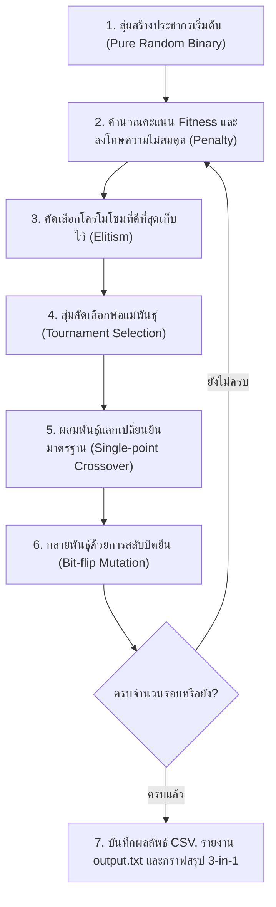

# 🏆 GeneTeam: ระบบจัดแบ่งทีมกีฬา 2 สีด้วย Genetic Algorithm (Pure GA)

โครงงานนี้พัฒนาขึ้นเพื่อแบ่งพนักงานจำนวน **358 คน** (จากไฟล์ `HR(in).csv`) ออกเป็น **2 สี (สีแดง / สีเขียว)** ตามโจทย์ 2 ด้านหลัก:
1. **ความแฟนเนจด้านกีฬา (Sports Fairness)**: สมดุลทางกายภาพและทักษะกีฬา (สัดส่วนเพศ ชาย-หญิง เท่ากัน, ค่าเฉลี่ยอายุ, น้ำหนัก, ส่วนสูง, BMI และทักษะกีฬาเฉลี่ยเท่ากัน)
2. **การสร้างความรู้จักข้ามแผนก (Harmonization)**: กระจายสมาชิกจากทั้ง 19 แผนก (A - S) ลงในทั้ง 2 สีอย่างเท่าเทียมที่สุด

> [!NOTE]
> โค้ดนี้ใช้ **Pure Genetic Algorithm** โดย**นำการรีบาลานซ์แบบฮาร์ดโค้ดออก (No Rebalance / Repair Loop)** โดยปล่อยให้อัลกอริทึม GA ปรับสมดุลขนาดทีม 179 : 179 คนและค้นหาคำตอบที่ดีที่สุดอย่างเป็นธรรมชาติผ่าน Penalty Function

---

## 🧬 1. การแทนโครโมโซม (Chromosome Representation)

โครโมโซมแทนด้วย **Binary List ของเลข 0 และ 1** ความยาว 358 ช่อง (เท่ากับจำนวนคนทั้งหมด):
* **`0`** = สมาชิกคนนี้อยู่ **ทีมสีแดง (Team Red)**
* **`1`** = สมาชิกคนนี้อยู่ **ทีมสีเขียว (Team Green)**

---

## 🎯 2. การออกแบบ Fitness Function (Objective & Penalty)

ประเมินความเหมาะสมเต็ม 100 คะแนน โดยให้ GA ปรับตัวผ่านระบบคะแนนและบทลงโทษ (Penalty):
1. **ขนาดทีม (Team Size Balance)**: ปรับลดคะแนนตามผลต่างจำนวนคนของทั้งสองทีม ทำให้ GA บรรจบที่ขนาดทีม 179 : 179 คนโดยไม่ต้องมีลูปบังคับซ่อมแซม
2. **ด้านกีฬา (Sports Fairness)**:
   * **ทักษะกีฬา (Sports Skill)**: ประเมินจาก BMI, สัดส่วนความสูง และอายุ
   * **สัดส่วนเพศ (Gender Balance)**: นับจำนวนผู้ชายและผู้หญิงให้สมดุลเท่ากัน
   * **กายภาพเฉลี่ย (Mean Age, Weight, Height, BMI)**: เปรียบเทียบค่าเฉลี่ยของทั้งสองสี
3. **ด้านแผนก (Harmonization)**:
   * คำนวณการกระจายตัวของสมาชิกครบทั้ง 19 แผนก (A - S)

---

## ⚙️ 3. ขั้นตอนการทำงานของ Genetic Algorithm (Pure GA)



---

## 🚀 วิธีการรันโปรแกรม

```powershell
python main.py
```

---

## 📊 ผลลัพธ์ที่ได้จากการรันจริง (Dataset: HR(in).csv)

* **ความสมดุลขนาดทีม (Team Balance)**: ทีมสีแดง **179 คน** : ทีมสีเขียว **179 คน** (ผลต่าง 0 คน สมดุล 50:50)
* **ความแฟนเนจด้านกีฬา (Sports Fairness)**:
  * ทักษะกีฬาเฉลี่ย (Sports Skill): สีแดง **74.05** | สีเขียว **73.91** (ต่างกันเพียง 0.15 คะแนน)
  * ส่วนเบี่ยงเบนมาตรฐาน (Std Dev): สีแดง **5.82** | สีเขียว **6.21**
  * สัดส่วนผู้ชาย (Male): สีแดง **61 คน** : สีเขียว **61 คน** (ต่าง 0 คน เป๊ะ 100%)
  * สัดส่วนผู้หญิง (Female): สีแดง **118 คน** : สีเขียว **118 คน** (ต่าง 0 คน เป๊ะ 100%)
  * น้ำหนักเฉลี่ย (Weight): สีแดง **72.86 kg** | สีเขียว **71.36 kg** (ต่างกันเพียง 1.50 kg)
  * ส่วนสูงเฉลี่ย (Height): สีแดง **168.77 cm** | สีเขียว **167.07 cm** (ต่างกันเพียง 1.69 cm)
  * ค่าเฉลี่ยอายุ (Age): สีแดง **41.47 ปี** | สีเขียว **41.01 ปี** (ต่างกันเพียง 0.46 ปี)
  * ดัชนีมวลกายเฉลี่ย (BMI): สีแดง **25.29** | สีเขียว **25.28** (ต่างกันเพียง 0.01)
* **การกระจายสมาชิกข้ามแผนก (Harmonization)**:
  * กระจายสมาชิกครบทั้ง 19 แผนก (A - S) อย่างสมดุล แผนกที่เป็นเลขคู่แบ่งครึ่งเท่ากัน เช่น แผนก D (72 คน) แบ่งได้ 36 : 36 คน

### 📈 กราฟสรุปผลการประเมิน 3-in-1 (ความละเอียดสูง 300 DPI):
รูปกราฟรวมทั้ง 3 ด้านอยู่ในไฟล์เดียว: `outputs/summary_plots.png` ประกอบด้วย:
1. **Fitness Progression**: เส้นแสดงการลู่เข้าหาคำตอบที่ดีที่สุดของ GA
2. **Sports Skill Distribution & Means/Variance**: Boxplot แสดงการกระจายตัวพร้อมจุด Scatter และแท่งเปรียบเทียบ Mean & Std Dev พร้อมตัวเลขกำกับ
3. **Cross-Department Harmonization**: กราฟแท่งเปรียบเทียบการกระจายสมาชิกครบทั้ง 19 แผนก พร้อมตัวเลขจำนวนคนบนทุกแท่ง

---

## 📁 โครงสร้างโปรเจกต์

```
d:\กีฬา\
├── data/
│   └── HR(in).csv            # ชุดข้อมูลพนักงาน 358 คน (19 แผนก)
├── outputs/
│   ├── team_assignment.csv   # รายชื่อผลลัพธ์ว่าใครอยู่สีไหน (358 คน)
│   ├── summary_plots.png     # กราฟรวมผลการประเมินทั้ง 3 ด้านในไฟล์เดียว (300 DPI)
│   └── output.txt            # รายงานสรุปสถิติและรายชื่อจัดทีมฉบับสมบูรณ์
├── main.py                   # โค้ด Pure Genetic Algorithm ทั้งหมดในไฟล์เดียว
├── output.txt                # รายงานสรุปสถิติและรายชื่อจัดทีม (root)
├── requirements.txt          # ไลบรารีที่จำเป็น (pandas, matplotlib, numpy)
└── README.md                 # เอกสารอธิบายโครงงานฉบับสมบูรณ์
```
