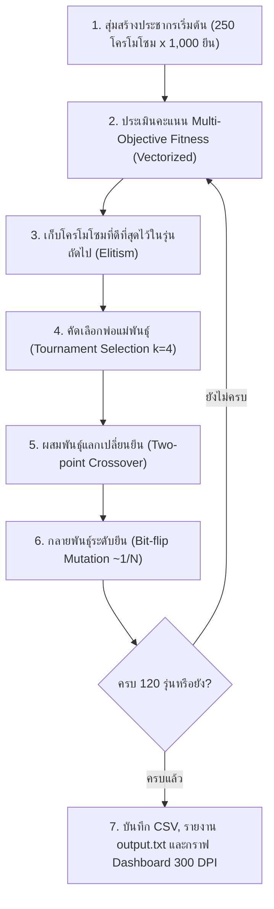

# 🏆 ระบบจัดแบ่งทีมกีฬาองค์กร 2 สีด้วย Genetic Algorithm (Enterprise HR Edition)

โครงงานการประยุกต์ใช้ **Genetic Algorithm (Pure GA)** สำหรับจัดแบ่งพนักงานองค์กรจำนวน **1,000 คน** (จากชุดข้อมูล `data/HR(in).csv` ครอบคลุม **19 แผนกสายงาน**) ออกเป็น **2 ทีมสี (ทีมสีแดง / ทีมสีเขียว)** ทีมละ **500 คน** โดยมุ่งเน้นวัตถุประสงค์หลัก 2 ด้าน:

1. **ความแฟนเนจด้านกีฬาและสรีระ (Sports Fairness & Biometrics)**: ให้ทั้ง 2 สีมีความสมดุลกันทั้งทักษะกีฬาเฉลี่ย (`Mean Sports Skill`), การกระจายตัวของทักษะ (`Std Dev`), สัดส่วนเพศชาย–หญิง (`Gender Parity`), อายุ (`Age`), น้ำหนัก (`Weight`), ส่วนสูง (`Height`) และดัชนีมวลกาย (`BMI`)
2. **การสร้างความรู้จักข้ามแผนก (Cross-Department Harmonization)**: กระจายพนักงานจากทั้ง **19 แผนกสายงาน (`A` ถึง `S`)** ลงในทั้ง 2 สีในสัดส่วน `50:50` อย่างเท่าเทียมที่สุด

---

## 🧬 1. การออกแบบ Genetic Algorithm (Pure GA - No Hard-coded Rebalance)

ระบบนี้ออกแบบตามหลัก **Pure Genetic Algorithm** มาตรฐานสากล โดย**ไม่ใช้ลูปบังคับซ่อมแซมจำนวนคน (No Repair / Rebalance Loop)** แต่ให้อัลกอริทึมเรียนรู้และปรับสมดุลเองผ่าน **Multi-Objective Penalty Fitness Function**:

* **Chromosome Representation**: อาร์เรย์เลขฐานสอง (`0` และ `1`) ความยาว `1,000` ยีน
  * `0` = สมาชิกอยู่ **ทีมสีแดง (Team Red)**
  * `1` = สมาชิกอยู่ **ทีมสีเขียว (Team Green)**
* **Population Initialization**: สุ่มสร้างประชากรเริ่มต้นแบบอิสระ (`POP_SIZE = 250`, `GENS = 120`)
* **Selection**: Tournament Selection ($k = 4$) คัดเลือกพ่อแม่พันธุ์ที่มีค่า Fitness สูง
* **Crossover**: Two-point Crossover มาตรฐาน สลับช่วงยีนระหว่างพ่อและแม่พันธุ์
* **Mutation**: Bit-flip Mutation มาตรฐานในอัตรา $\sim 1/N$ เพื่อรักษาการสำรวจคำตอบใหม่โดยไม่ทำลายโครงสร้างโครโมโซมที่ดี
* **Elitism**: เก็บรักษาโครโมโซมที่ดีที่สุด 6 อันดับแรกไว้ในรุ่นถัดไปเสมอ



---

## 🎯 2. สูตรการคำนวณความเหมาะสมและความแม่นยำ (Fitness & Evaluation Function)

ประเมินจากคะแนนเต็ม `100` คะแนน หักด้วยความคลาดเคลื่อนจริงในทุกมิติ:

$$\text{Fitness Score} = 100 - \text{Penalty}_{\text{Size}} - \text{Penalty}_{\text{Sports}} - \text{Penalty}_{\text{Department}}$$

1. **ความสมดุลขนาดทีม ($\text{Penalty}_{\text{Size}}$)**: หักคะแนนตามผลต่างจำนวนคน $|\text{Red} - \text{Green}| \times 0.45$
2. **ความแฟนเนจด้านกีฬา ($\text{Penalty}_{\text{Sports}}$)**: หักคะแนนจากผลต่างค่าเฉลี่ยทักษะกีฬา (`Mean Skill`), ส่วนเบี่ยงเบนมาตรฐาน (`Std Dev`), สัดส่วนเพศชาย–หญิง, อายุ, น้ำหนัก, ส่วนสูง และ BMI
3. **ความสมดุลข้ามแผนก ($\text{Penalty}_{\text{Department}}$)**: หักคะแนนจากผลรวมความต่างจำนวนคนในแต่ละแผนกครบทั้ง 19 แผนก $\sum_{d=1}^{19} |\text{Red}_d - \text{Green}_d| \times 0.85$

---

## 📊 3. ผลลัพธ์จากการรันจริง (Dataset: `HR(in).csv` — 1,000 คน, 19 แผนก)

| หมวดหมู่การประเมิน | ตัวชี้วัด (Metric) | ทีมสีแดง (Red) | ทีมสีเขียว (Green) | ผลต่าง (Diff) | ระดับความแม่นยำ / สถานะ |
| :--- | :--- | :---: | :---: | :---: | :---: |
| **ภาพรวม (Overall)** | **Best Fitness Score** | — | — | — | **95.70 / 100 (95.70%)** |
| **ขนาดทีม (Team Size)** | จำนวนสมาชิกทั้งหมด | **500 คน** | **500 คน** | **0 คน** | **สมดุล 100%** |
| **สัดส่วนเพศ (Gender)** | พนักงานชาย (Male) | **240 คน** | **240 คน** | **0 คน** | **สมดุล 100%** |
| | พนักงานหญิง (Female) | **260 คน** | **260 คน** | **0 คน** | **สมดุล 100%** |
| **สมรรถภาพกีฬา (Sports)** | ทักษะกีฬาเฉลี่ย (Mean Skill) | **60.22** | **60.26** | **0.04** | **ความสมดุลกีฬา 97.76%** |
| | ส่วนเบี่ยงเบนมาตรฐาน (Std Dev) | **15.93** | **15.93** | **0.00** | **การกระจายตัวเท่ากันเป๊ะ** |
| **สรีระและอายุ (Biometrics)** | น้ำหนักเฉลี่ย (Weight) | **63.08 kg** | **63.51 kg** | **0.43 kg** | สมดุล |
| | ส่วนสูงเฉลี่ย (Height) | **166.68 cm** | **166.63 cm** | **0.06 cm** | สมดุล |
| | อายุเฉลี่ย (Age) | **34.38 ปี** | **34.33 ปี** | **0.04 ปี** | สมดุล |
| | ดัชนีมวลกายเฉลี่ย (BMI) | **22.61** | **22.78** | **0.16** | สมดุล |
| **การกระจายแผนก (19 แผนก)** | แผนกเลขคู่ (15 แผนก) | แบ่งครึ่งเท่ากัน | แบ่งครึ่งเท่ากัน | **0 คนทุกแผนก** | **ครบ 15 / 15 แผนก (100%)** |
| | แผนกเลขคี่ (4 แผนก: F, L, O, R) | ต่าง 1 คน | ต่าง 1 คน | **1 คน** | **ความสมดุลแผนก 94.60%** |

### กราฟสรุปผลการประเมิน 3-in-1 Dashboard (`outputs/summary_plots.png`):


---

## 🚀 4. วิธีการติดตั้งและรันโปรแกรม

```powershell
# 1. ติดตั้งไลบรารีที่จำเป็น
pip install -r requirements.txt

# 2. รันโปรแกรมจัดแบ่งทีมและสร้างกราฟอัตโนมัติ
python main.py
```

---

## 📁 5. โครงสร้างไฟล์ในโปรเจกต์

```text
d:\กีฬา\
├── data/
│   └── HR(in).csv               # ชุดข้อมูลพนักงาน 1,000 คน (19 แผนกสายงาน A - S)
├── outputs/
│   ├── team_assignment.csv      # ตารางผลลัพธ์การจัดทีมสีแดง/สีเขียวครบทั้ง 1,000 คน
│   ├── summary_plots.png        # กราฟ Dashboard สรุปผล 3 มิติในภาพเดียว (ความละเอียด 300 DPI)
│   └── output.txt               # รายงานสรุปสถิติและรายชื่อสมาชิกแยกทีมฉบับเต็ม
├── main.py                      # โค้ดประมวลผล Genetic Algorithm และการสร้างกราฟ
├── output.txt                   # รายงานสรุปสถิติและรายชื่อสมาชิกแยกทีม (Root)
├── requirements.txt             # รายการไลบรารีที่ใช้ในโปรเจกต์
└── README.md                    # เอกสารอธิบายโครงงานและสรุปผลการทดลอง
```
