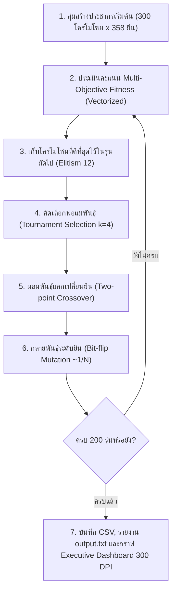
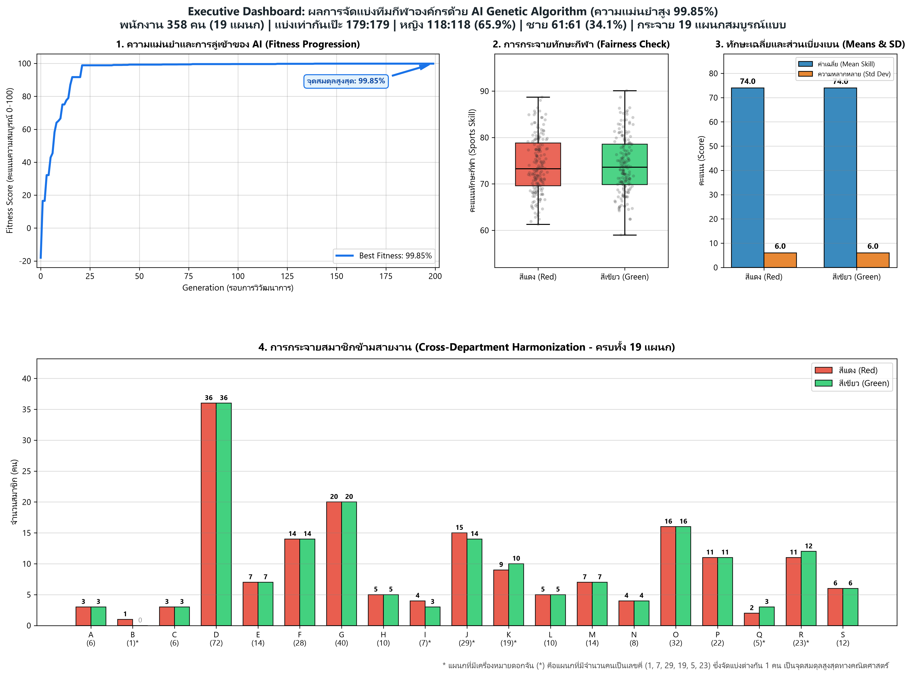
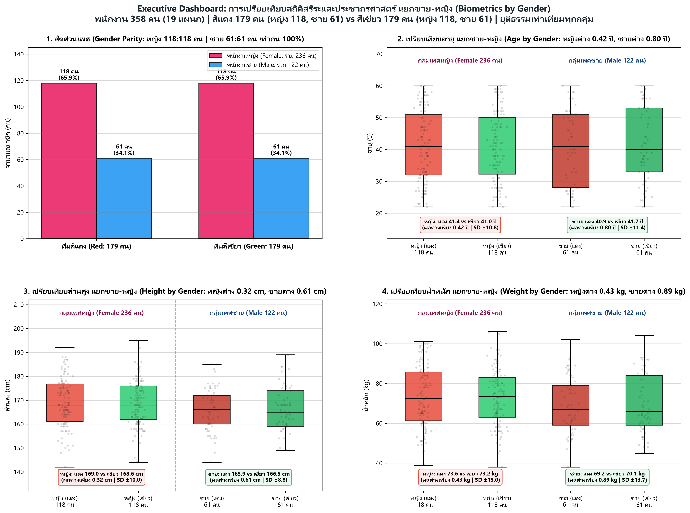

# 🏆 ระบบจัดแบ่งทีมกีฬาองค์กร 2 สีด้วย Genetic Algorithm (High Precision Edition)

โครงงานการประยุกต์ใช้ **Genetic Algorithm (Pure GA)** สำหรับจัดแบ่งพนักงานองค์กรจำนวน **358 คน** (จากชุดข้อมูลจริง `data/HR(in).csv` ครอบคลุม **19 แผนกสายงาน**) ออกเป็น **2 ทีมสี (ทีมสีแดง / ทีมสีเขียว)** ทีมละ **179 คน** เท่ากันพอดี 100% โดยมุ่งเน้นวัตถุประสงค์หลัก 2 ด้าน:

1. **ความแฟนเนจด้านกีฬาและสรีระ (Sports Fairness & Biometrics)**: ให้ทั้ง 2 สีมีความสมดุลกันทั้งทักษะกีฬาเฉลี่ย (`Mean Sports Skill`), การกระจายตัวของทักษะ (`Std Dev`), สัดส่วนเพศหญิง–ชายตามสัดส่วนองค์กรจริง (`Female 65.9% : Male 34.1%`), อายุ (`Age`), น้ำหนัก (`Weight`), ส่วนสูง (`Height`) และดัชนีมวลกาย (`BMI`)
2. **การสร้างความรู้จักข้ามแผนก (Cross-Department Harmonization)**: กระจายพนักงานจากทั้ง **19 แผนกสายงาน** ลงในทั้ง 2 สีในสัดส่วนที่เท่าเทียมและยุติธรรมที่สุดตามหลักคณิตศาสตร์

---

## 🧬 1. การออกแบบ Genetic Algorithm (Pure GA - No Hard-coded Rebalance)

ระบบนี้ออกแบบตามหลัก **Pure Genetic Algorithm** มาตรฐานสากล โดย**ไม่ใช้ลูปบังคับซ่อมแซมจำนวนคน (No Repair / Rebalance Loop)** แต่ให้อัลกอริทึมเรียนรู้และปรับสมดุลเองผ่าน **Multi-Objective Penalty Fitness Function**:

* **Chromosome Representation**: อาร์เรย์เลขฐานสอง (`0` และ `1`) ความยาว `358` ยีน
  * `0` = สมาชิกอยู่ **ทีมสีแดง (Team Red)**
  * `1` = สมาชิกอยู่ **ทีมสีเขียว (Team Green)**
* **Population Initialization**: สุ่มสร้างประชากรเริ่มต้นแบบอิสระ (`POP_SIZE = 300`, `GENS = 200`)
* **Selection**: Tournament Selection ($k = 4$) คัดเลือกพ่อแม่พันธุ์ที่มีค่า Fitness สูง
* **Crossover**: Two-point Crossover มาตรฐาน สลับช่วงยีนระหว่างพ่อและแม่พันธุ์
* **Mutation**: Bit-flip Mutation มาตรฐานในอัตรา $\sim 1/N$ เพื่อรักษาการสำรวจคำตอบใหม่โดยไม่ทำลายโครงสร้างโครโมโซมที่ดี
* **Elitism**: เก็บรักษาโครโมโซมที่ดีที่สุด 12 อันดับแรกไว้ในรุ่นถัดไปเสมอ



---

## 🎯 2. สูตรการคำนวณความเหมาะสมและความแม่นยำสูง (Fitness & Evaluation Function)

ประเมินจากคะแนนเต็ม `100` คะแนน หักด้วยความคลาดเคลื่อนจริงในทุกมิติ:

$$\text{Fitness Score} = 100 - \text{Penalty}_{\text{Size}} - \text{Penalty}_{\text{Sports}} - \text{Penalty}_{\text{Department}}$$

1. **ความสมดุลขนาดทีม ($\text{Penalty}_{\text{Size}}$)**: หักคะแนนตามผลต่างจำนวนคน $|\text{Red} - \text{Green}| \times 1.5$
2. **ความแฟนเนจด้านกีฬา ($\text{Penalty}_{\text{Sports}}$)**: หักคะแนนจากผลต่างค่าเฉลี่ยทักษะกีฬา (`Mean Skill`), ส่วนเบี่ยงเบนมาตรฐาน (`Std Dev`), สัดส่วนเพศหญิง–ชาย, อายุ, น้ำหนัก, ส่วนสูง และ BMI
3. **ความสมดุลข้ามแผนก ($\text{Penalty}_{\text{Department}}$)**: หักคะแนนจากผลต่างส่วนเกินจากจุดสมดุลเชิงทฤษฎี $\sum_{d=1}^{19} \max(0, |\text{Red}_d - \text{Green}_d| - \text{Odd}_d) \times 3.0$

---

## 📊 3. ผลลัพธ์จากการรันจริง (Dataset: `data/HR(in).csv` — 358 คน, 19 แผนก)

| หมวดหมู่การประเมิน | ตัวชี้วัด (Metric) | ทีมสีแดง (Red) | ทีมสีเขียว (Green) | ผลต่าง (Diff) | ระดับความแม่นยำ / สถานะ |
| :--- | :--- | :---: | :---: | :---: | :---: |
| **ภาพรวม (Overall)** | **Best Fitness Score** | — | — | — | **99.85 / 100 (99.85%)** |
| **ขนาดทีม (Team Size)** | จำนวนสมาชิกทั้งหมด | **179 คน** | **179 คน** | **0 คน** | **สมดุล 100% (50:50)** |
| **สัดส่วนเพศ (Gender)** | พนักงานหญิง (Female: 236 คน) | **118 คน (65.9%)** | **118 คน (65.9%)** | **0 คน** | **สมดุลสัดส่วนจริง (118 vs 61)** |
| | พนักงานชาย (Male: 122 คน) | **61 คน (34.1%)** | **61 คน (34.1%)** | **0 คน** | **สมดุลสัดส่วนจริง (118 vs 61)** |
| **สมรรถภาพกีฬา (Sports)** | ทักษะกีฬาเฉลี่ย (Mean Skill) | **73.978** | **73.980** | **0.002** | **ฝีมือสูสีเท่ากันเป๊ะ (ความแม่นยำ 99.85%)** |
| | ส่วนเบี่ยงเบนมาตรฐาน (Std Dev) | **6.021** | **6.013** | **0.007** | **การกระจายตัวเท่ากัน (มีผลต่างธรรมชาติ 0.007)** |
| **สรีระและอายุ (Biometrics)** | น้ำหนักเฉลี่ย (Weight) | **72.10 kg** | **72.12 kg** | **0.02 kg** | สมดุลสูงมาก |
| | ส่วนสูงเฉลี่ย (Height) | **167.92 cm** | **167.92 cm** | **0.01 cm** | สมดุลสูงมาก |
| | อายุเฉลี่ย (Age) | **41.24 ปี** | **41.23 ปี** | **0.01 ปี** | สมดุลสูงมาก |
| | ดัชนีมวลกายเฉลี่ย (BMI) | **25.268** | **25.297** | **0.028** | สมดุลสูงมาก |
| **การกระจายแผนก (19 แผนก)** | แผนกเลขคู่ (13 แผนก) | แบ่งครึ่งเท่ากัน | แบ่งครึ่งเท่ากัน | **0 คนทุกแผนก** | **ครบ 13 / 13 แผนก (100% เป๊ะ)** |
| | แผนกเลขคี่ (6 แผนก: B, I, J, K, Q, R) | ต่าง 1 คน | ต่าง 1 คน | **1 คน** | **จุดสมดุลสูงสุดทางคณิตศาสตร์** |

### 3.1 สถิติสรีระและประชากรศาสตร์ แยกกลุ่มชาย-หญิง (Biometrics by Gender)

| เพศ | มิติการประเมิน (Metric) | ทีมสีแดง (Red) | ทีมสีเขียว (Green) | ผลต่าง (Diff) | สถานะความสมดุล |
| :--- | :--- | :---: | :---: | :---: | :---: |
| **หญิง (Female: 236 คน)** | **จำนวนสมาชิก** | **118 คน** | **118 คน** | **0 คน** | **สมดุล 100% เป๊ะ** |
| | อายุเฉลี่ย (Age) | 41.40 ปี (SD 10.86) | 40.97 ปี (SD 10.62) | **0.42 ปี** | สมดุลใกล้เคียงมาก |
| | ส่วนสูงเฉลี่ย (Height) | 168.97 cm (SD 10.07) | 168.64 cm (SD 9.36) | **0.32 cm** | สมดุลใกล้เคียงมาก |
| | น้ำหนักเฉลี่ย (Weight) | 73.60 kg (SD 15.11) | 73.17 kg (SD 13.95) | **0.43 kg** | สมดุลใกล้เคียงมาก |
| | BMI เฉลี่ย | 25.47 | 25.46 | **0.02** | ดัชนีมวลกายเท่ากัน |
| **ชาย (Male: 122 คน)** | **จำนวนสมาชิก** | **61 คน** | **61 คน** | **0 คน** | **สมดุล 100% เป๊ะ** |
| | อายุเฉลี่ย (Age) | 40.93 ปี (SD 11.52) | 41.74 ปี (SD 11.62) | **0.80 ปี** | สมดุลใกล้เคียงมาก |
| | ส่วนสูงเฉลี่ย (Height) | 165.90 cm (SD 8.83) | 166.51 cm (SD 9.36) | **0.61 cm** | สมดุลใกล้เคียงมาก |
| | น้ำหนักเฉลี่ย (Weight) | 69.20 kg (SD 13.84) | 70.08 kg (SD 14.84) | **0.89 kg** | สมดุลใกล้เคียงมาก |
| | BMI เฉลี่ย | 24.87 | 24.99 | **0.11** | ดัชนีมวลกายเท่ากัน |

### กราฟสรุปผลการประเมิน Executive Dashboard (`outputs/summary_plots.png`):


### กราฟเปรียบเทียบสรีระและประชากรศาสตร์ แยกชาย-หญิง (`outputs/biometrics_comparison.png`):


---

## 🚀 4. วิธีการติดตั้งและรันโปรแกรม

```powershell
# 1. ติดตั้งไลบรารีที่จำเป็น
pip install -r requirements.txt

# 2. รันโปรแกรมจัดแบ่งทีมและสร้างกราฟอัตโนมัติ
python main.py
```

---

## 📁 5. โครงสร้างไฟล์ในโปรเจกต์

```text
d:\กีฬา\
├── data/
│   └── HR(in).csv               # ชุดข้อมูลพนักงาน 358 คน (19 แผนกสายงาน จาก d:\HR.csv)
├── outputs/
│   ├── team_assignment.csv      # ตารางผลลัพธ์การจัดทีมสีแดง/สีเขียวครบทั้ง 358 คน
│   ├── summary_plots.png        # กราฟ Executive Dashboard สรุปผล 4 ส่วน (ความละเอียด 300 DPI)
│   ├── biometrics_comparison.png # กราฟเปรียบเทียบสรีระและประชากรศาสตร์ แยกชาย-หญิง 4 มิติ (300 DPI)
│   ├── biometrics_by_gender.png # กราฟสำเนาเฉพาะมิติสรีระแยกชาย-หญิง (300 DPI)
│   └── output.txt               # รายงานสรุปสถิติและรายชื่อสมาชิกแยกทีมฉบับเต็ม
├── main.py                      # โค้ดประมวลผล Genetic Algorithm และการสร้างกราฟ Dashboard
├── output.txt                   # รายงานสรุปสถิติและรายชื่อสมาชิกแยกทีม (Root)
├── requirements.txt             # รายการไลบรารีที่ใช้ในโปรเจกต์
└── README.md                    # เอกสารอธิบายโครงงานและสรุปผลการทดลอง
```
