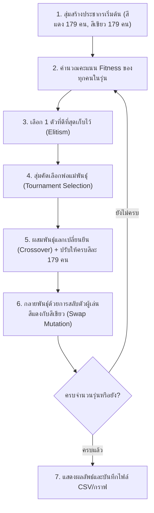
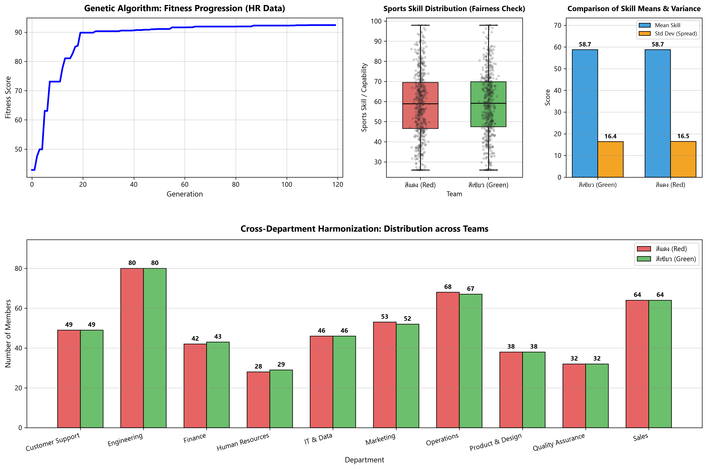

# 🏆 GeneTeam: ระบบจัดแบ่งทีมกีฬา 2 สีด้วย Genetic Algorithm (GA)

โครงงานนี้พัฒนาขึ้นเพื่อแบ่งพนักงานจำนวน **358 คน** (จากไฟล์ `HR(in).csv`) ออกเป็น **2 สี (สีแดง / สีเขียว)** สีละ 179 คนพอดี ตามโจทย์ 2 ข้อหลัก:
1. **ความแฟนเนจด้านกีฬา (Sports Fairness)**: สมดุลทางกายภาพระหว่าง 2 สี (สัดส่วนเพศ ชาย-หญิง เท่ากัน, ค่าเฉลี่ยอายุเท่ากัน, และค่าเฉลี่ยดัชนีมวลกาย BMI เท่ากัน)
2. **การสร้างความรู้จักข้ามแผนก (Harmonization)**: กระจายสมาชิกจากทั้ง 19 แผนก (A - S) ลงในทั้ง 2 สีอย่างเท่าเทียมที่สุด

---

## 🧬 1. การแทนโครโมโซม (Chromosome Representation)

โครโมโซมแทนด้วย **List ของเลข 0 และ 1** ความยาว 358 ช่อง (เท่ากับจำนวนคนทั้งหมด):
* **`0`** = สมาชิกคนนี้อยู่ **ทีมสีแดง (Team Red)**
* **`1`** = สมาชิกคนนี้อยู่ **ทีมสีเขียว (Team Green)**

* มีการคุมจำนวนสมาชิกให้มีเลข 0 จำนวน 179 ตัว และเลข 1 จำนวน 179 ตัวเท่ากันเสมอ (ทีมละ 179 คนพอดี 100%)

---

## 🎯 2. การออกแบบ Fitness Function

คำนวณจากผลต่างของทั้ง 2 ด้าน โดยหักออกจากคะแนนเต็ม 100 (ยิ่งผลต่างน้อย คะแนนยิ่งสูง):

1. **ด้านกีฬา (Sports Fairness)**:
   * **สัดส่วนเพศ (Gender Balance)**: นับจำนวนผู้ชายในสีแดงและสีเขียว
   * **อายุเฉลี่ย (Mean Age)**: เปรียบเทียบอายุเฉลี่ยของทั้งสองสี
   * **รูปร่างเฉลี่ย (Mean BMI)**: คำนวณจาก $\text{weight} / (\text{height}/100)^2$ แล้วเปรียบเทียบค่าเฉลี่ย
2. **ด้านแผนก (Harmonization)**:
   * วนลูปดูทั้ง 19 แผนก (A - S) แล้วหาผลต่างจำนวนคนที่อยู่สีแดงและสีเขียว

---

## ⚙️ 3. ขั้นตอนการทำงานของ Genetic Algorithm (GA)



---

## 🚀 วิธีการรันโปรแกรม

```powershell
python main.py
```

---

## 📊 ผลลัพธ์ที่ได้จากการรันจริง (Dataset: HR(in).csv)

* **คะแนน Fitness**: **99.41 / 100**
* **ความแฟนเนจด้านกีฬา (Sports Fairness)**:
  * สัดส่วนผู้ชาย (Male): สีแดง **61 คน** : สีเขียว **61 คน** (ต่าง 0 คน เป๊ะ 100%)
  * สัดส่วนผู้หญิง (Female): สีแดง **118 คน** : สีเขียว **118 คน** (ต่าง 0 คน เป๊ะ 100%)
  * น้ำหนักเฉลี่ย (Weight): สีแดง **72.08 kg** | สีเขียว **72.14 kg** (ต่างกันเพียง 0.06 kg)
  * ส่วนสูงเฉลี่ย (Height): สีแดง **167.92 cm** | สีเขียว **167.92 cm** (เท่ากันเป๊ะ)
  * ค่าเฉลี่ยอายุ (Age): สีแดง **41.27 ปี** | สีเขียว **41.20 ปี** (ต่างกันเพียง 0.07 ปี)
  * ดัชนีมวลกายเฉลี่ย (BMI): สีแดง **25.29** | สีเขียว **25.27** (ต่างกันเพียง 0.02)
* **การกระจายสมาชิกข้ามแผนก (Harmonization)**:
  * แผนกที่มีจำนวนคนเป็นเลขคู่ ถูกแบ่งครึ่ง 50:50 ครบทุกแผนก (เช่น แผนก D มี 72 คน แบ่งได้ 36 : 36)
  * แผนกที่มีจำนวนคนเป็นเลขคี่ ต่างกันเพียง 1 คน ซึ่งเป็นจุดสมดุลที่ดีที่สุดตามทฤษฎี (Excess Discrepancy = 0)

### กราฟสรุปผลการประเมินทั้ง 3 ด้านในภาพเดียว (3-in-1 Summary Dashboard):


---

## 📁 โครงสร้างโปรเจกต์

```
d:\กีฬา\
├── data/
│   └── HR(in).csv            # ชุดข้อมูลพนักงาน 358 คน (19 แผนก)
├── outputs/
│   ├── team_assignment.csv   # รายชื่อผลลัพธ์ว่าใครอยู่สีไหน (358 คน)
│   └── summary_plots.png     # กราฟรวมผลการประเมินทั้ง 3 ด้านในไฟล์เดียว
├── main.py                   # โค้ด Genetic Algorithm ทั้งหมดในไฟล์เดียว
├── requirements.txt          # ไลบรารีที่จำเป็น (pandas, matplotlib)
└── README.md                 # เอกสารอธิบายโครงงาน
```
