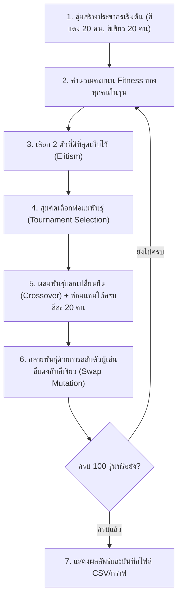
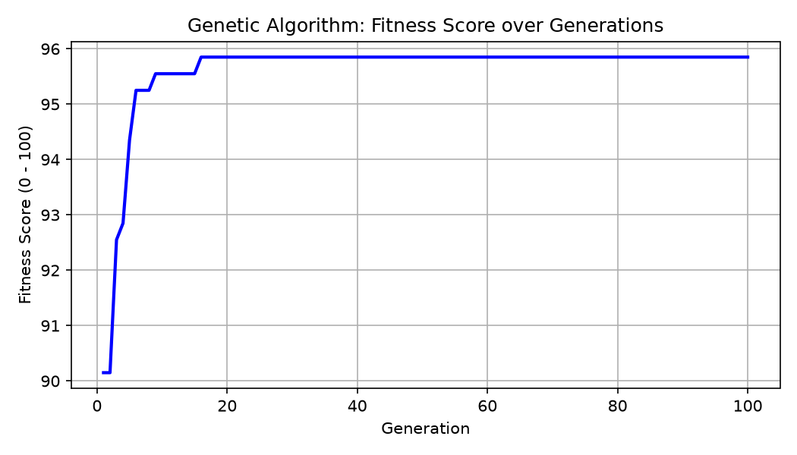

# 🏆 GeneTeam: ระบบจัดแบ่งทีมกีฬา 2 สีด้วย Genetic Algorithm (GA)

โครงงานนี้พัฒนาขึ้นเพื่อแบ่งคนจำนวน 40 คนออกเป็น **2 สี (สีแดง / สีเขียว)** ให้มีความเท่าเทียมกันตามโจทย์ 2 ข้อหลัก:
1. **ความแฟนเนจด้านกีฬา (Sports Fairness)**: ค่าเฉลี่ยสกิลกีฬาของทั้ง 2 สีต้องใกล้เคียงกันที่สุด เพื่อให้แข่งขันกันได้อย่างสูสีและสนุกสนาน
2. **การสร้างความรู้จักข้ามแผนก (Harmonization)**: สมาชิกจากแต่ละแผนกต้องกระจายตัวลงทั้ง 2 สีอย่างเท่าๆ กัน

---

## 🧬 1. การแทนโครโมโซม (Chromosome Representation)

โครโมโซมถูกแทนด้วย **List ของเลข 0 และ 1** ความยาว 40 ช่อง (เท่ากับจำนวนคนทั้งหมด):
* **`0`** = สมาชิกคนนี้อยู่ **ทีมสีแดง (Team Red)**
* **`1`** = สมาชิกคนนี้อยู่ **ทีมสีเขียว (Team Green)**

```
ตำแหน่ง (Index)  : [ 0,  1,  2,  3,  4, ..., 39 ]
โครโมโซม (Gene) : [ 0,  1,  1,  0,  0, ...,  1 ]
ทีมที่ได้         : [แดง, เขียว, เขียว, แดง, แดง, ..., เขียว]
```

* มีการคุมจำนวนสมาชิกให้มีเลข 0 จำนวน 20 ตัว และเลข 1 จำนวน 20 ตัวเท่ากันเสมอ (ทีมละ 20 คนพอดี)

---

## 🎯 2. การออกแบบ Fitness Function (ฟังก์ชันความเหมาะสม)

คะแนนเต็ม 100 คะแนน คำนวณจากผลต่างของทั้ง 2 ด้าน (ยิ่งผลต่างน้อย คะแนนยิ่งสูง):

$$\text{Fitness} = 100 - (\text{ผลต่างสกิลกีฬาเฉลี่ย} \times 3) - (\text{ผลต่างการกระจายแผนก} \times 2)$$

### วิธีคิดในโค้ด:
1. **ด้านกีฬา (Sports Fairness)**:
   * นำคะแนนสกิลกีฬาของคนสีแดงทุกคนมารวมกันแล้วหาค่าเฉลี่ย
   * นำคะแนนสกิลกีฬาของคนสีเขียวทุกคนมารวมกันแล้วหาค่าเฉลี่ย
   * หาผลต่าง: `sports_diff = abs(avg_red - avg_green)`
2. **ด้านแผนก (Harmonization)**:
   * วนลูปดูทีละแผนก ว่าคนในแผนกนั้นอยู่สีแดงกี่คน และอยู่สีเขียวกี่คน
   * หาผลต่าง: `dept_diff = sum(abs(count_red - count_green))`

---

## ⚙️ 3. ขั้นตอนการทำงานของ Genetic Algorithm (GA)



---

## 🚀 วิธีการรันโปรแกรม

รันคำสั่งเพียงบรรทัดเดียว:
```powershell
python main.py
```

รันการทดสอบ Unit Tests:
```powershell
python -m pytest tests/test_ga.py -v
```

---

## 📊 ตัวอย่างผลลัพธ์ที่ได้จากการรัน

* **Best Fitness**: **95.85 / 100**
* **ค่าเฉลี่ยสกิลกีฬา ทีมสีแดง**: 60.50
* **ค่าเฉลี่ยสกิลกีฬา ทีมสีเขียว**: 60.45
* **ผลต่างคะแนนเฉลี่ยกีฬา**: **0.05 แต้ม** (สูสีกันมาก)
* **การกระจายสมาชิกข้ามแผนก**:
  * Engineering (10 คน) $\rightarrow$ สีแดง 5 คน : สีเขียว 5 คน (แบ่งครึ่ง 50:50)
  * Marketing (8 คน) $\rightarrow$ สีแดง 4 คน : สีเขียว 4 คน (แบ่งครึ่ง 50:50)
  * Sales (8 คน) $\rightarrow$ สีแดง 4 คน : สีเขียว 4 คน (แบ่งครึ่ง 50:50)
  * Design (4 คน) $\rightarrow$ สีแดง 2 คน : สีเขียว 2 คน (แบ่งครึ่ง 50:50)
  * Human Resources (5 คน) $\rightarrow$ สีแดง 3 คน : สีเขียว 2 คน (สัดส่วนดีที่สุดสำหรับเลขคี่)
  * Finance (5 คน) $\rightarrow$ สีแดง 2 คน : สีเขียว 3 คน (สัดส่วนดีที่สุดสำหรับเลขคี่)

### กราฟการพัฒนาของค่า Fitness:


---

## 📁 โครงสร้างโปรเจกต์แบบเรียบง่าย

```
d:\กีฬา\
├── data/
│   └── company_members.csv   # ข้อมูลสมาชิก 40 คน
├── outputs/
│   ├── team_assignment.csv   # รายชื่อผลลัพธ์ว่าใครอยู่สีไหน
│   └── fitness_evolution.png # กราฟแสดงการลู่เข้าของค่าฟิตเนส
├── tests/
│   └── test_ga.py            # Unit tests ตรวจสอบความถูกต้อง
├── main.py                   # โค้ดหลักทั้งระบบ (อ่านและเข้าใจได้ง่ายในไฟล์เดียว)
├── requirements.txt          # ไลบรารีที่ใช้ (pandas, matplotlib, pytest)
└── README.md                 # เอกสารอธิบายโครงงาน
```
